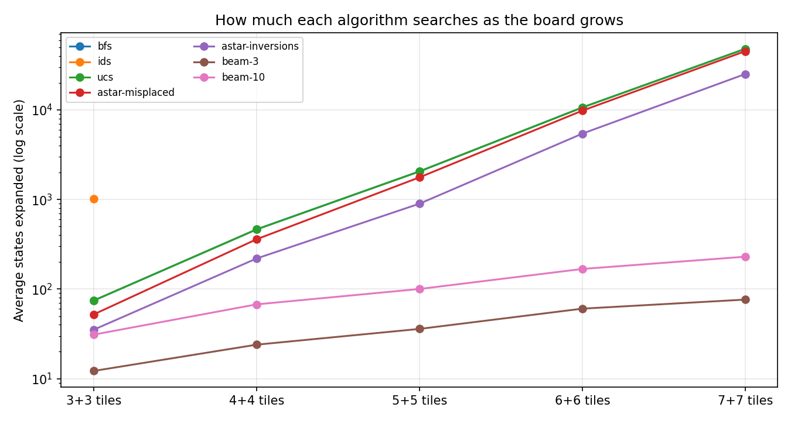

# Sliding Puzzle Search

[](https://github.com/jocelync07/sliding-puzzle-search/actions/workflows/tests.yml)

Classic AI search algorithms (**BFS, iterative deepening, uniform-cost, A\* with two heuristics, and beam search**) on a tile-sorting sliding puzzle, with a benchmark that measures how much each one has to search.

## The puzzle

A row holds two kinds of tiles, `A` and `B`, and one blank `_`. A move puts a tile into the blank, either sliding it from the next cell or **jumping it over up to two other tiles**. The goal is every `A` to the left of every `B`, with the blank anywhere.

```
$ python -m puzzle BA_BAAB
Start: B A _ B A A B   algorithm: astar[inversions]
  1. _ A B B A A B   tile 0 -> 2 (jump over 1, cost 1)
  2. A _ B B A A B   tile 1 -> 0 (slide, cost 1)
  3. A A B B _ A B   tile 4 -> 1 (jump over 2, cost 1)
  4. A A _ B B A B   tile 2 -> 4 (jump over 1, cost 1)
  5. A A A B B _ B   tile 5 -> 2 (jump over 2, cost 1)
Solved in 5 moves, cost 5, 34 states expanded, 0.3 ms.
```

The board size, the jump limit and the cost of a move can all be changed: `--max-jump`, and `--cost distance` to make longer jumps cost more.

## Algorithms

| Algorithm | Finds the best solution? | Memory | Notes |
|---|---|---|---|
| Breadth-first search | Yes (fewest moves) | High | Explores level by level |
| Iterative deepening | Yes (fewest moves) | Very low | Repeats depth-limited DFS with a growing limit, so it redoes work |
| Uniform-cost search | Yes (cheapest) | High | Works with any move costs |
| A\* + misplaced tiles | Yes | High | Guided by a heuristic |
| A\* + inversions | Yes | High | Guided by a stronger heuristic |
| Beam search (width 3 / 10) | No | Very low | Keeps only the best few states per level |

### Heuristics

Both heuristics look only at the order of the tiles, ignoring the blank:

- **Misplaced tiles:** how many `B` tiles sit where the `A` tiles should be. One move moves one tile, so it can fix at most one of these.
- **Inversions:** how many pairs are in the wrong order (a `B` before an `A`), divided by the jump limit. A tile that jumps over *k* tiles changes order with exactly those *k*, so one move fixes at most *max_jump* inversions.

Neither heuristic can overestimate the remaining cost, so A\* stays optimal. The tests check this exhaustively: they compare both heuristics with the true cost from **every** state of the 3+3 board, for both cost models and two jump limits.

## Results

30 random start states per board size (seed 42). Full table: [`results/benchmark.md`](results/benchmark.md).



| Board | BFS | A\* misplaced | A\* inversions | Beam-10 (best found) |
|---|---|---|---|---|
| 3+3 tiles | 74 states | 52 | **35** | 31 (30/30) |
| 5+5 tiles | 2,059 | 1,768 | **898** | 100 (25/30) |
| 7+7 tiles | 48,043 | 45,194 | **25,154** | 230 (12/30) |

*Average states expanded. Beam column: states expanded, then (starts where it found the best solution / 30).*

What the numbers show:

- **A good heuristic halves the work.** A\* with inversions expands about half as many states as BFS at every size, and still always finds the best solution. Misplaced tiles helps much less, because it only notices the tiles that cross the A/B boundary.
- **Iterative deepening trades time for memory.** On 3+3 it expands 14× more states than BFS (1,025 vs 74) because each new depth limit repeats the earlier search. But it only keeps one path in memory. Beyond 3+3 it takes minutes per start, so the benchmark skips it there.
- **Beam search is fast but gives up quality.** Width 10 expands about 1% of what A\* does on 7+7, but finds the best solution in only 12 of 30 starts. Width 3 doesn't even solve 21 of them, because the solution path gets pruned away.

## Run it

Needs Python 3.9 or newer. The solver has no dependencies; the chart uses matplotlib.

```bash
pip install -r requirements.txt
python -m puzzle "B B A _ A B A"                    # solve one start (A* by default)
python -m puzzle BBBB_AAAA -a beam-10 --cost distance
python benchmark.py                                   # rebuild results/ (about 1 minute)
pytest -v
```

## Project structure

```
puzzle/
  board.py        rules: states, legal moves, goal test, move costs
  heuristics.py   misplaced tiles and inversions
  search.py       BFS, IDS, UCS, A*, beam search
  __main__.py     command-line solver
benchmark.py      compare all algorithms; writes results/
tests/            rules, heuristic admissibility, optimality and edge cases
```
